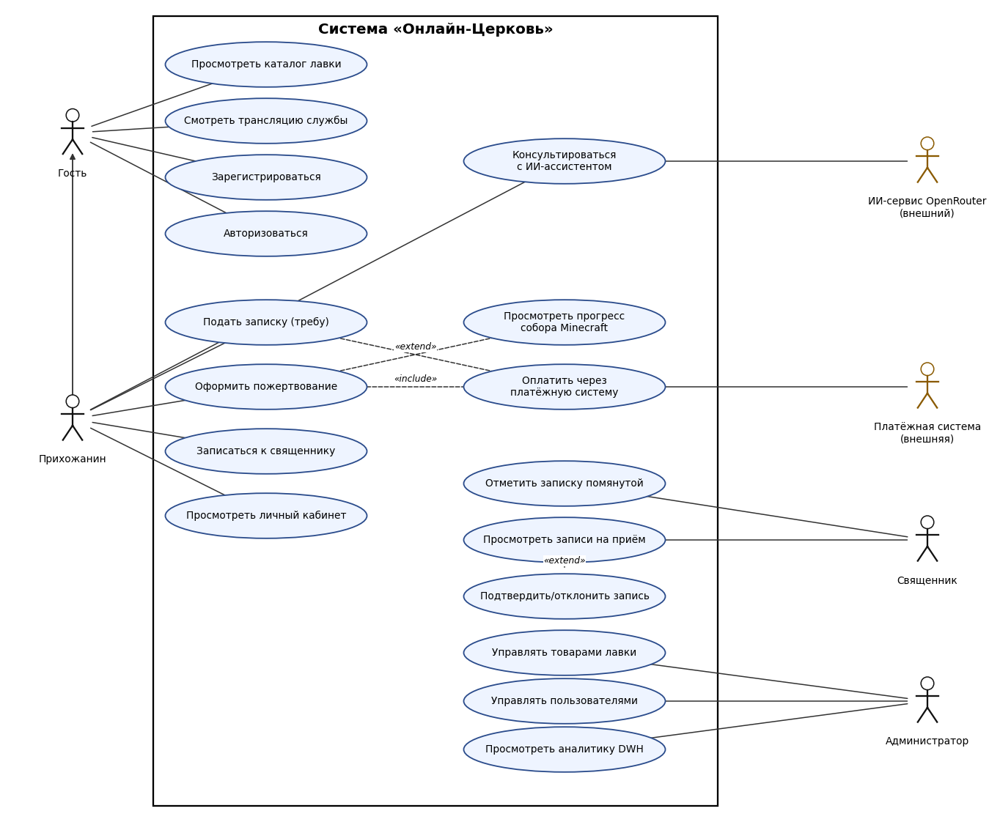
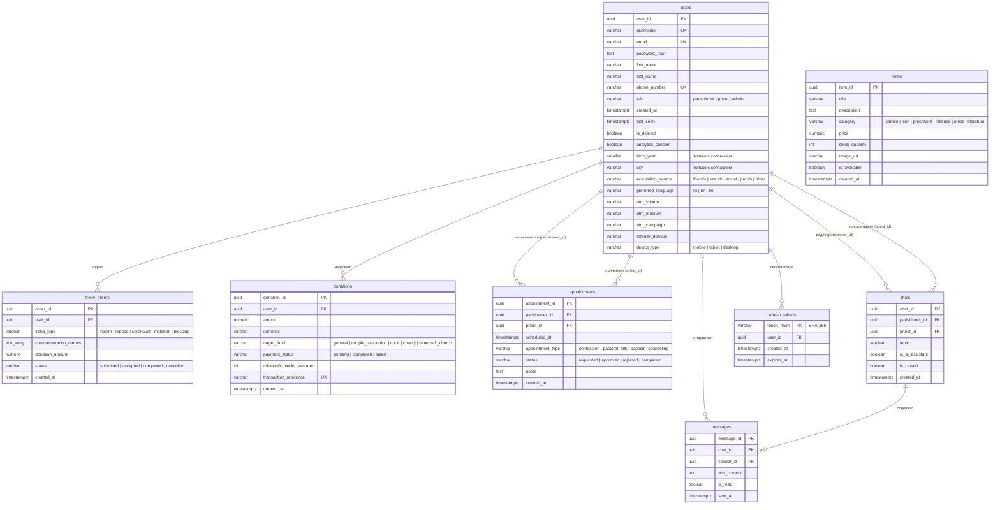

# Online Church — Backend

REST API серверной части сервиса «Онлайн-Церковь» (православный приход): церковная лавка, подача записок (треб), пожертвования, запись к священнику и ИИ-консультант.

## Описание проекта
Пользователи регистрируются в системе, просматривают каталог церковной лавки, подают записки о здравии и об упокоении, жертвуют на фонды (1 доллар = 1 блок собора Minecraft), записываются на беседу к священнику и общаются с ИИ-ассистентом. Священники подтверждают записи, администраторы управляют каталогом и пользователями.

## Стек технологий
| Компонент | Технология |
|---|---|
| Язык / фреймворк | Python 3.12, FastAPI, Uvicorn |
| ORM и валидация | SQLAlchemy 2.0, Pydantic v2 |
| База данных | PostgreSQL 16 (`psycopg2-binary`) |
| ИИ-консультант | OpenRouter API (DeepSeek) или The Hive, клиент `httpx` |
| Инфраструктура | Docker, Docker Compose, GitHub Actions (Ruff + Pytest) |

## Запуск
```bash
docker compose up --build        # из корня репозитория
# API:     http://localhost:8080
# Swagger: http://localhost:8080/docs
```

## База данных и каталог
Backend работает с БД через SQLAlchemy (`app/models.py`, `app/db.py`). Адрес задаётся переменной `DATABASE_URL`:
- в Docker Compose это PostgreSQL (`postgres_dwh`): таблицы создаёт `docs/church_db_init.sql`, недостающие (`shop_orders`, `shop_order_lines`) backend добавляет сам при старте;
- локально без Docker это файл SQLite `backend/church_dev.db` (создаётся автоматически, в git не попадает).

При старте пустая таблица `items` заполняется демо-каталогом (`app/data.py`; `SEED_ON_STARTUP=false` отключает). Через БД работают каталог (поиск, фильтры, сортировка), заказы с уменьшением остатков и пожертвования. Пожертвования принимаются только в долларах США (`USD`, константа `CURRENCY` в `app/models.py`).

## Авторизация и роли
Код: `app/security.py` (пароли, токены, проверка ролей), `app/api/auth.py`, `app/api/users.py`.

- **Пароли** хешируются bcrypt. Требования: от 10 символов, не длиннее 72 байт в UTF-8 (дальше bcrypt не читает), буква и цифра, не совпадает с email или именем пользователя (без учёта регистра).
- **Email** хранится в нижнем регистре; email и имя пользователя уникальны без учёта регистра (для имени — уникальный индекс на `lower(username)`, чтобы одновременные «Olga» и «olga» не прошли обе).
- **Access-токен** — JWT (HS256), подписанный `JWT_SECRET`; значения по умолчанию нет, без секрета backend не стартует. В токене только `sub` (id пользователя), `iat` и `exp`; срок жизни — `JWT_EXPIRE_MINUTES` (60 мин).
- **Refresh-токен** — случайная строка в cookie `refresh_token` (`HttpOnly; SameSite=Strict; Path=/api/v1/auth; Secure`), живёт `REFRESH_EXPIRE_DAYS` (30 дней). В таблице `refresh_tokens` хранится только SHA-256 от него. `/auth/refresh` выдаёт по нему новый access-токен (вход переживает F5), `/auth/logout` удаляет эту сессию, смена пароля удаляет все сессии пользователя, кроме новой для текущего браузера.
- **CORS** с `allow_credentials=True` и списком адресов из `CORS_ORIGINS` (по умолчанию `http://localhost:3000`): фронтенд шлёт запросы `/auth/*` с `credentials: 'include'`. Значение `*` с cookie браузеры не принимают, поэтому backend с ним не стартует.
- **Аналитика регистраций**: необязательные поля профиля (согласие, год рождения, город, источник, язык, UTM-метки, домен реферера, тип устройства) — см. [docs/API.md](../docs/API.md#авторизация). Год рождения и город хранятся только при `analytics_consent=true` (ограничение `ck_users_demographics_consent`).
- **Роль и признак удаления** берутся из БД при каждом запросе, а не из токена: смена роли или удаление пользователя действуют сразу.
- **Перебор паролей**: после 5 неудачных входов (или неверных текущих паролей при смене пароля) за 15 минут с одного адреса для одного email вход блокируется (`429` + `Retry-After`) до конца окна. Счётчик хранится в памяти процесса: он обнуляется при перезапуске backend, а при нескольких процессах (`uvicorn --workers N`) у каждого свой. Для учебного проекта этого достаточно; в продакшене счётчик стоит вынести в Redis или БД.
- При регистрации роль всегда `parishioner`, поле `role` в запросе игнорируется. Роль меняет администратор: `PATCH /api/v1/users/{user_id}/role`.

Новые колонки `users` и таблица `refresh_tokens` есть в `docs/church_db_init.sql`. Таблицы backend создаёт при старте, но колонки в уже существующую таблицу `users` не добавляет. Старую базу нужно пересоздать: удалить `backend/church_dev.db` или выполнить `docker compose down -v`. Можно и мигрировать: `analytics/sql/05_users_registration_profile.sql`.

Защита эндпоинта по ролям:
```python
from ..security import get_current_user, require_roles

@router.patch("/{order_id}")
def update(order_id: uuid.UUID, user: User = Depends(require_roles("priest", "admin"))): ...
```
Без токена или с недействительным токеном — `401`, с неподходящей ролью — `403`.

Первого администратора назначают в БД:
```bash
docker compose exec postgres_dwh psql -U church_admin -d church_dwh -c "UPDATE users SET role='admin' WHERE email='admin@example.com';"
```

## ИИ-консультант: провайдеры
`CHAT_PROVIDER=openrouter` (по умолчанию) или `hive`. У обоих одинаковые формат ответа, перебор моделей из списка (`OPENROUTER_MODEL` / `HIVE_MODEL`, через запятую) и тексты ошибок; различается только запрос к сервису (`app/api/chat.py`, `app/services/hive.py`). Без ключа выбранного провайдера чат работает в демо-режиме. Переменные описаны в [.env.example](../.env.example) и [docs/API.md](../docs/API.md).

## Роли пользователей и варианты использования
| Роль | Действия в системе |
|---|---|
| **Гость** | просматривает каталог лавки и трансляции, регистрируется, входит |
| **Прихожанин** | всё, что гость; подаёт записки, оформляет пожертвования, записывается к священнику, консультируется с ИИ, пользуется личным кабинетом |
| **Священник** | просматривает записи на приём, подтверждает или отклоняет их, отмечает записки помянутыми |
| **Администратор** | управляет товарами лавки и пользователями, просматривает аналитику DWH |
| **Платёжная система, ИИ-сервис (OpenRouter или The Hive)** | внешние системы, к которым обращается приложение |



Исходник диаграммы (draw.io): [use-case-diagram.drawio](use-case-diagram.drawio)

## Схема БД (ER-диаграмма)
DDL: [docs/church_db_init.sql](../docs/church_db_init.sql)



Таблица `items` не связана внешними ключами: заказы товаров в текущей версии не оформляются.

## API
Полное описание эндпоинтов и JSON-контрактов: [docs/API.md](../docs/API.md). Интерактивная документация доступна в Swagger UI: `/docs`.

| Метод | Путь | Назначение |
|---|---|---|
| GET | `/health` | проверка работоспособности |
| POST | `/api/v1/auth/register`, `/api/v1/auth/login` | регистрация и вход (JWT + refresh-cookie) |
| POST | `/api/v1/auth/refresh`, `/api/v1/auth/logout` | новый access-токен по cookie; выход |
| GET, PATCH | `/api/v1/auth/me` | профиль текущего пользователя: чтение и изменение (любая роль) |
| POST | `/api/v1/auth/change-password` | смена пароля (любая роль) |
| PATCH | `/api/v1/users/{user_id}/role` | смена роли (admin) |
| GET | `/api/v1/items` | каталог лавки |
| POST | `/api/v1/treby` | подача записки |
| POST | `/api/v1/donations` | пожертвование |
| POST | `/api/v1/appointments` | запись к священнику |
| POST | `/api/v1/chats/ai/messages` | сообщение ИИ-ассистенту |

## Команда
Константин Ващеня (Team Lead), Соболевский Евгений (Backend), Цыро Тамара (Frontend), Нарель Антон (QA).
